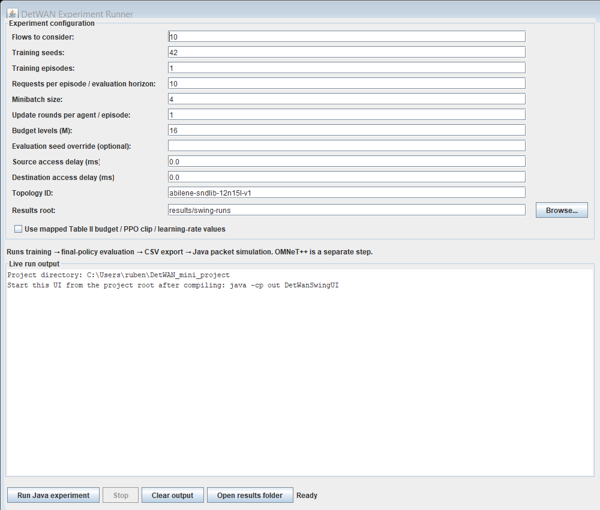
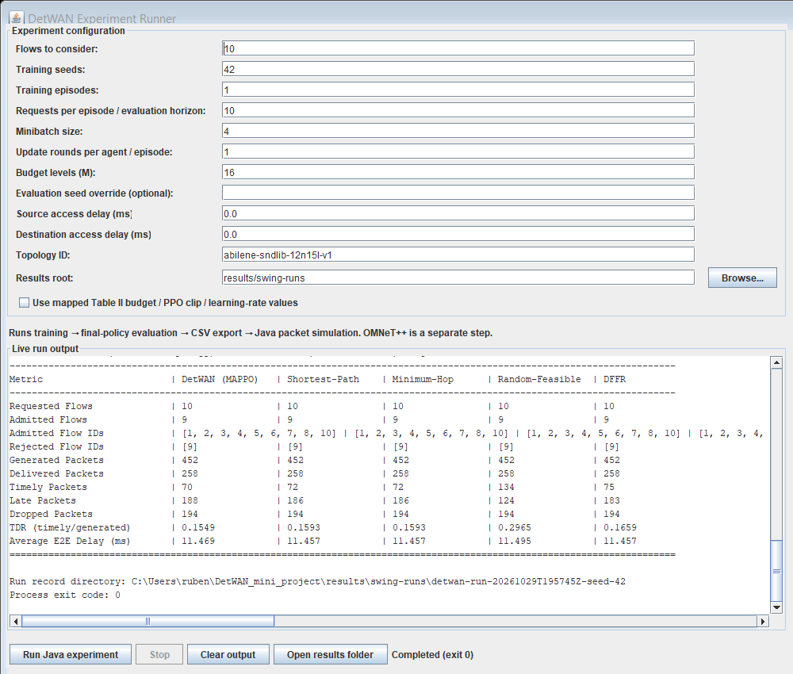

# DetWAN: Toward Deterministic Wide-Area Networks via Deadline-Aware Routing and Scheduling

A Java implementation, evaluation framework, and graphical user interface reproducing and extending concepts from the IEEE paper:
> **"Toward Deterministic Wide-Area Networks via Deadline-Aware Routing and Scheduling"**

This repository provides an educational discrete-event packet simulation, Multi-Agent Proximal Policy Optimization (MAPPO) with Cascade Earliest Deadline First (CEDF) scheduling, established baseline routing schemes, and the proposed **DFFR (Deadline-Aware Feasibility-First Routing)** baseline.

---

## 1. Key Features and Algorithms

The project compares five routing and deadline-budget allocation algorithms under CEDF packet scheduling:

1. **DetWAN-MAPPO + CEDF**: Multi-agent reinforcement learning where routers act as decentralized agents selecting the next hop and discrete per-hop deadline budget ($\delta$). Uses centralized critic state estimation and Action Space masking to enforce local delay bounds.
2. **Shortest-Path + CEDF**: Deterministic baseline routing along physical shortest propagation delay paths with uniform budget allocation.
3. **Minimum-Hop + CEDF**: Selects paths with the fewest router hops and uniform deadline budgets.
4. **Random-Feasible + CEDF**: Uniformly samples from all feasible loop-free candidate paths and valid discrete budget sequences.
5. **DFFR + CEDF (Proposed Extension)**: Deadline-Aware Feasibility-First Routing that searches loop-free paths and valid discrete budget allocations, selecting the fewest-hop candidate that satisfies end-to-end deadline constraints and link reservation bounds before committing network state.

### CEDF Scheduling (Algorithm 1)
Packet transmission is prioritized by cumulative deadline rank $B_f^h = \sum_{i=1}^h \delta_f^i$. Arriving packets are queued in strictly ascending rank order, with FIFO tie-breaking preserving arrival order for equal ranks as specified in Algorithm 1 of the paper.

---

## 2. Repository Structure

```
DetWAN_mini_project/
├── dataset/
│   ├── abilene.txt                                                          # SNDlib 12-node 15-link Abilene topology definition
│   └── directed-abilene-zhang-5min-over-6months-ALL-native/
│       └── demandMatrix-abilene-zhang-5min-20040301-0145.txt                # Benchmark traffic demand matrix
├── docs/
│   ├── packet-simulation-model.md                                           # Java packet simulation mechanics and timing
│   └── SWING_UI.md                                                          # Swing GUI usage guide
├── examples/
│   ├── OMNET_BATCH_V1.md                                                    # OMNeT++ Batch Export Specification (V1-V3)
│   └── detwan-omnet-batch-v1.example.csv                                    # Sample OMNeT++ batch export
├── results/
│   └── dffr-cedf-fifo-20261030/                                             # Validated 5-algorithm FIFO benchmark (seeds 42, 101, 2024)
│       ├── aggregate-metrics.csv                                            # Summary metrics across all seeds
│       ├── all-seeds-comparison.csv                                         # Per-seed breakdown
│       ├── timely-delivery-ratio-comparison.png                             # TDR comparison chart
│       ├── per-seed-tdr-comparison.png                                      # Per-seed TDR variability chart
│       ├── average-end-to-end-delay.png                                     # End-to-end delay comparison chart
│       ├── packet-outcomes.png                                              # Timely, late, and dropped packet distribution
│       ├── flow-admission-comparison.png                                    # Flow admission count comparison
│       └── runs/                                                            # Full per-seed run properties and logs
├── src/
│   ├── dataset/                                                             # Topology and traffic matrix loaders
│   ├── main/                                                                # Main CLI, Swing GUI, and unit tests
│   ├── network/                                                             # Network topology, routers, and links
│   ├── routing/                                                             # MAPPO, PPO actors/critics, DFFR, Baselines, RouteCascade
│   ├── scheduling/                                                          # CEDF packet scheduler (Algorithm 1)
│   ├── simulation/                                                          # Discrete packet event simulator and batch exporter
│   └── traffic/                                                             # Flow definitions, packet modeling, and burst generators
├── sources.txt                                                              # Java source manifest
├── ui_initial.png                                                           # Screenshot: Swing GUI initial state
├── ui_simulated.png                                                         # Screenshot: Swing GUI post-simulation results
├── .gitignore                                                               # Git exclusion rules
└── README.md                                                                # Project documentation
```

---

## 3. Prerequisites

- **Java Development Kit**: JDK 17 or higher (tested on OpenJDK / Oracle JDK 25 LTS).
- **Operating System**: Windows, Linux, or macOS.
- **Git**: Version 2.30+ for version control.

---

## 4. Compilation

Compile all Java source files into the `out/` directory using the provided `sources.txt` manifest:

### Windows PowerShell:
```powershell
javac -d out @sources.txt
```

### Linux / macOS:
```bash
javac -d out $(cat sources.txt)
```

---

## 5. Running the Test Suite

The project includes 28 standalone regression and unit test classes covering mathematical foundations, MAPPO reinforcement learning, CEDF scheduling, and baseline routing:

```powershell
# Run individual tests
java -cp out CEDFTest
java -cp out DFFRBaselineTest
java -cp out DeadlineSatisfiabilityTest

# Run full test suite (PowerShell)
Get-ChildItem -Path src\main -Filter *Test.java | ForEach-Object {
    $name = $_.BaseName
    java -cp out $name 2>&1 | Out-Null
    if ($LASTEXITCODE -eq 0) { Write-Host "PASSED: $name" } else { Write-Host "FAILED: $name" }
}
```

---

## 6. Graphical User Interface (Swing)

Launch the interactive Swing interface:

```powershell
java -cp out DetWanSwingUI
```

### Key UI Features:
- **Parameter Controls**: Easily configure flows to consider, seeds, training episodes, horizon, minibatch size, budget levels ($M$), and access delays.
- **Table II Preset**: Toggle mapped paper Table II hyperparameters with one click.
- **Live Asynchronous Output**: Streams simulation logs, flow-level admission decisions, and the comparison summary table in real time without blocking the UI.
- **One-Click Results Access**: Click **Open results folder** to instantly open the active run folder in your file manager.


*Figure: DetWAN Swing GUI ready for simulation.*


*Figure: DetWAN Swing GUI showing 5-algorithm comparison results.*

---

## 7. Command-Line Experiment Execution

To run headless batch experiments across multiple random seeds:

```powershell
java -cp out Main --flows 10 --seeds 42,101,2024 --episodes 1 --horizon 10 `
                  --minibatch-size 4 --update-rounds 1 --budget-levels 16 `
                  --results-root results/my-experiment
```

### Supported Arguments:
- `--flows <int>`: Number of ingress flows to consider from the Abilene demand matrix (default: 10).
- `--seeds <seed1,seed2,...>`: Comma-separated list of training seeds.
- `--budget-levels <int>`: Number of discrete deadline budget levels $M$ (paper default: 16).
- `--episodes <int>`: Training episodes per agent (default: 1).
- `--horizon <int>`: Request horizon per episode (default: equal to flows).
- `--minibatch-size <int>`: PPO training minibatch size (default: 4).
- `--source-access-delay-ms <double>`: Ingress endpoint access delay in ms (default: 0.0).
- `--destination-access-delay-ms <double>`: Egress endpoint access delay in ms (default: 0.0).
- `--paper-table-ii`: Applies mapped Table II budget levels, PPO clip, and learning rate values.
- `--results-root <path>`: Destination directory for run logs, CSV outputs, and batch exports.

---

## 8. Experimental Results Summary (FIFO-CEDF)

Results evaluated on 10 flows over 3 independent seeds (`42, 101, 2024`) with discrete budget levels $M=16$:

| Algorithm | Mean Admitted Flows | Mean Generated Packets | Mean Delivered Packets | Mean Timely Packets | Mean Timely Delivery Ratio (TDR) | Mean Avg E2E Delay (ms) |
| :--- | :---: | :---: | :---: | :---: | :---: | :---: |
| **DetWAN-MAPPO** | 9.00 / 10 | 452.0 | 258.0 | 70.0 | **15.49%** | 11.469 |
| **Shortest-Path** | 9.00 / 10 | 452.0 | 258.0 | 69.0 | **15.27%** | 11.457 |
| **Minimum-Hop** | 9.00 / 10 | 452.0 | 258.0 | 69.0 | **15.27%** | 11.457 |
| **Random-Feasible**| 9.00 / 10 | 452.0 | 258.0 | 119.7 | **26.48%** | 11.488 |
| **DFFR (Proposed)**| 9.00 / 10 | 452.0 | 258.0 | 106.0 | **23.45%** | 11.457 |

### Packet Accounting Invariant
Across all algorithms and seeds, the simulator strictly verifies:
- $\text{Generated Packets} = \text{Delivered Packets} + \text{Dropped Packets}$ ($452 = 258 + 194$)
- $\text{Delivered Packets} = \text{Timely Packets} + \text{Late Packets}$
- $\text{TDR} = \frac{\text{Timely Packets}}{\text{Generated Packets}}$

---

## 9. Assumptions and Limitations

1. **Topology Variant**: Uses the SNDlib 12-node, 15-link (30 directed links) Abilene topology (`abilene-sndlib-12n15l-v1`), which retains ATLAM5. This is an SNDlib standard representation and is not identical to the 11-node, 14-link graph in some figures of the IEEE paper.
2. **Workload Model**: Replays the first $N$ requests of the Abilene Zhang dataset (`20040301-0145`). Full historical archives (48,000+ snapshots) are excluded to maintain repository portability.
3. **Discrete Simulation**: Includes a fast standalone Java discrete-event packet queue simulator. For hardware-accurate OMNeT++ simulations, export batches using `--results-root` to generate version 3 batch files for OMNeT++.

---

## 10. License

This project is prepared for academic and research evaluation. Dataset files originate from the SNDlib library and Abilene traffic measurement archives.
